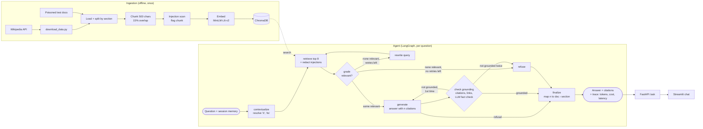
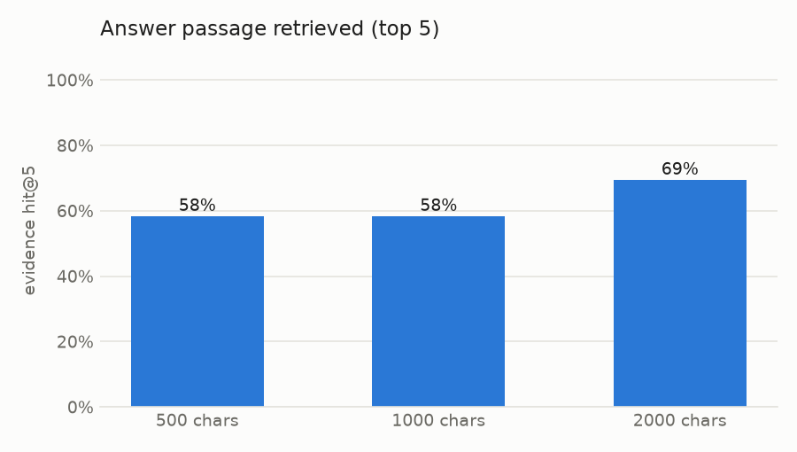
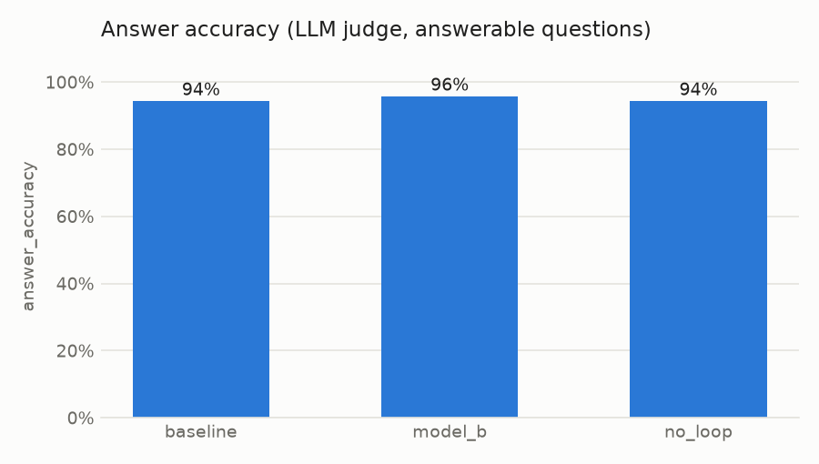
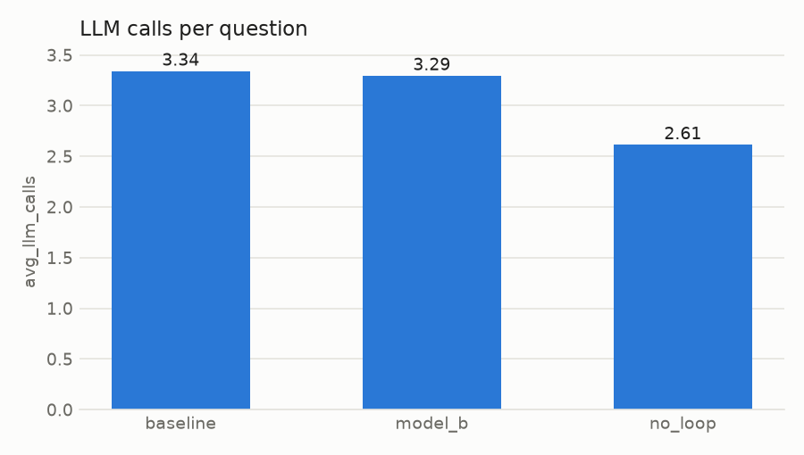

# 🪐 Agentic RAG Research Assistant

Ask questions about a collection of 41 Wikipedia articles on the **Solar System**.
The assistant is an *agent* rather than a single prompt. It:

1. **searches** the documents (vector search over ChromaDB),
2. **judges** whether the passages it found are actually relevant,
3. **rewrites its search query and tries again** if they are not (up to a limit),
4. **answers with citations** (document › section, with a link),
5. **checks its own answer** against the passages, and
6. **says "I could not find the answer in the documents."** instead of guessing.

It also resists **prompt injection hidden inside documents**, logs every step
with **tokens, latency and cost**, remembers the **conversation** within a
session, and ships with an **evaluation suite** (44 questions, LLM-as-judge).

| Built with | |
|---|---|
| Agent | [LangGraph](https://langchain-ai.github.io/langgraph/) (an explicit state graph) |
| Retrieval | [ChromaDB](https://www.trychroma.com/) + `all-MiniLM-L6-v2` ([sentence-transformers](https://www.sbert.net/)) |
| LLM | Groq (`openai/gpt-oss-120b`) by default; Google Gemini, OpenAI or local Ollama with a one-line config change |
| App | FastAPI backend + Streamlit chat UI, Dockerfile |
| Quality | pytest (54 offline tests + 8 live-LLM tests), evaluation scripts, charts |

> **Results at a glance** (44-question eval set, measured with `gemini-3.5-flash-lite`,
> the default before the switch to Groq):
> **94% answer accuracy**, **100% correct refusals** on unanswerable questions,
> **2% hallucination rate**, **97% of answers cite the right article**, all 8 live
> prompt-injection attacks resisted, **~$0.85 per 1,000 questions**.
> Two experiments (chunk sizes 1000/2000) stopped early on the free-tier daily
> quota; see [Evaluation](#evaluation).

---

## Architecture



Read [docs/ARCHITECTURE.md](docs/ARCHITECTURE.md) for every file and the full
data flow, and [docs/DECISIONS.md](docs/DECISIONS.md) for why each design choice
was made, with the numbers behind it.

---

## Setup (step by step)

You need **Python 3.11 or 3.12** and about 2 GB of disk space. The commands are
for Linux/macOS; on Windows use `.venv\Scripts\activate` instead of `source …`.

```bash
# 1. Create a virtual environment (an isolated folder for this project's packages).
#    If your system Python is 3.13+ use uv to get 3.12: `uv venv --python 3.12 .venv`
python3.12 -m venv .venv
source .venv/bin/activate

# 2. Install PyTorch (CPU-only build: much smaller), then everything else.
pip install torch --index-url https://download.pytorch.org/whl/cpu
pip install -r requirements.txt
pip install -e .            # makes `import rag_assistant` work everywhere

# 3. Add your API key. The default LLM runs on Groq: create a free key at
#    https://console.groq.com/keys (sign in, "Create API Key", copy it once).
cp .env.example .env        # then open .env and paste the key after GROQ_API_KEY=
#    .env is git-ignored; never commit it. The app reads it on start-up.
#    Using Gemini instead? Put GOOGLE_API_KEY=... in .env and see "Switch the LLM".
#    The evaluation judge uses Gemini, so running the evals needs GOOGLE_API_KEY too.

# 4. Download the 41 Wikipedia articles (~1.8 MB of text, takes ~1 minute).
python scripts/download_data.py

# 5. Build the vector database (~1 minute on a laptop CPU).
#    Building 1000 and 2000 as well is only needed for the experiments.
python -m rag_assistant.ingest --chunk-sizes 500 1000 2000

# 6. Check everything works (no API key needed for these).
pytest                      # offline tests; `pytest -m llm` runs the live-LLM ones
```

### Use it

```bash
# Ask a single question from the terminal (shows each agent step as it runs):
python scripts/ask.py "How many active volcanoes does Io have?"

# Or run the web app: start the API, then the UI in a second terminal.
uvicorn rag_assistant.api:app --reload          # API docs: http://localhost:8000/docs
streamlit run app/streamlit_app.py              # chat UI:  http://localhost:8501
```

Example API call:

```bash
curl -X POST localhost:8000/ask -H 'content-type: application/json' \
     -d '{"question": "Who discovered Enceladus?", "session_id": "demo"}'
```

The response contains `answer`, `citations` (title, section, url),
`refused`, the search `queries` the agent tried, the passages used, and `usage`
(tokens, cost in US$, latency) plus a per-step trace. Every question is also
appended to `logs/traces.jsonl`.

### Switch the LLM

Edit `config.yaml`, or set environment variables for one run, e.g.
`RAG_LLM_PROVIDER=gemini RAG_LLM_MODEL=gemini-3.5-flash-lite python scripts/ask.py "…"`:

| Provider | `llm_provider` | Example `llm_model` | Needs |
|---|---|---|---|
| Groq (default) | `groq` | `openai/gpt-oss-120b` (or `qwen/qwen3.8-27b`) | `GROQ_API_KEY` |
| Google Gemini | `gemini` | `gemini-3.5-flash-lite` | `GOOGLE_API_KEY` |
| OpenAI | `openai` | `gpt-4o-mini` | `OPENAI_API_KEY` |
| Local Ollama | `ollama` | `llama3.1:8b` | [Ollama](https://ollama.com) running, no key |

### Docker

```bash
docker build -t rag-assistant .
docker run --env-file .env -p 8000:8000 -v rag_chroma:/app/chroma_db rag-assistant
```

On first start the container downloads the articles and builds the vector
store. The `Dockerfile` header shows how to run the Streamlit UI from the same image.

---

## Evaluation

* **Eval set:** [`eval/questions.jsonl`](eval/questions.jsonl): 44 questions, made up of
  36 answerable questions with reference answers and 8 unanswerable ones (off-topic, plus
  false-premise traps like *"What is the name of the fourth moon of Mars?"*).
  Every answerable question stores an exact **evidence quote**, and a test checks
  that the quote really exists in its source article.
* **Metrics:**
  * answer accuracy (LLM-as-judge vs the reference: 1 / 0.5 / 0)
  * citation hit rate and precision
  * correct-refusal and false-refusal rates
  * hallucination rate
  * retrieval recall, latency (mean, p95), tokens and cost per question
* **Judge:** `gemini-3.5-flash-lite`, kept fixed across all experiments. It is the
  same model as the default agent, which risks self-preference bias. A stronger judge
  from another family was not available on the free tier (see Limitations).

### Results: retrieval (measured)

`python scripts/eval_retrieval.py` scores the 36 answerable questions against each
chunk size. *Evidence hit* means the passage containing the answer was retrieved.

| Chunk size × passages | Right article in results | **Answer passage retrieved** | MRR | Context per search |
|---|---|---|---|---|
| **500 chars × top 8 (chosen)** | 97% | **75%** | 0.90 | **3.1k chars** |
| 1000 chars × top 5 (first default) | 97% | 58% | 0.90 | 3.9k chars |
| 2000 chars × top 3 | 97% | 39% | 0.93 | 4.0k chars |
| 2000 chars × top 8 | 100% | 83% | 0.94 | 10.6k chars |



At the same context budget, **many small chunks beat a few large ones** by
17–36 points. Large chunks only catch up when the LLM gets ~3.4× more text,
which costs more and makes the answering step slower. The full grid is in
[`results/retrieval_chunk_sizes.md`](results/retrieval_chunk_sizes.md).

### Results: end-to-end experiments (measured)

Each experiment changes **one** thing against the baseline (chunk 500 × top 8,
rewrite loop on, `gemini-3.5-flash-lite`, up to 2 rewrites). 44 questions each.

| Experiment | Answer accuracy | Correct refusals | False refusals | Hallucination | Right article cited | LLM calls / q | Cost / 1k q | Mean latency |
|---|---|---|---|---|---|---|---|---|
| **baseline** | **94.4%** | 100% | 2.8% | 2.3% | 97.1% | 3.34 | $0.85 | 10.5 s |
| `no_loop` (no query rewriting) | 94.4% | 100% | 2.8% | 2.3% | 97.1% | 2.61 | $0.71 | 11.7 s |
| `model_b` (`gemini-3.1-flash-lite`) | 95.8% | 100% | 0.0% | 2.3% | 97.2% | 3.30 | $0.68 | 16.8 s |
| `chunk_1000` *(20 of 44 q)* | 100% | — | 0% | 0% | 95.0% | 3.10 | $0.93 | 13.2 s |
| ↳ baseline on the same 20 q | 90.0% | — | 5.0% | 5.0% | 100% | 2.95 | $0.74 | 9.0 s |




**What the numbers say** (details in [docs/DECISIONS.md](docs/DECISIONS.md)):

* **The rewrite loop never fired for an answerable question at top-8 retrieval.**
  All 16 rewrites in the baseline went to the 8 unanswerable questions, which were
  refused anyway. They added 28% more LLM calls for no gain. With narrower retrieval
  (`chunk_1000`, top 5) the loop **rescued** a question: *"Who discovered Ceres?"*
  found nothing relevant, the rewritten query *"Ceres discovery date discoverer
  Giuseppe Piazzi"* did, and the answer was correct. That one rescue needed one
  rewrite, so the final setting keeps the loop but with **`max_retries: 1`**.
* **The two models are tied on quality.** They differ by one question out of 44.
  `gemini-3.1-flash-lite` is ~20% cheaper; `3.5-flash-lite` (default) was faster in this run.
* **Only 2 baseline errors:** one wrong refusal (Ceres) and one "incorrect" that is
  really an eval-set flaw. For *"How fast can the Great Red Spot's winds get?"* the agent
  answered 432 km/h, which the article does say (winds at the spot's edge), while the
  reference only had 496 km/h. So the true accuracy is probably slightly higher.
* **Chunk size is not settled end-to-end.** On 20 questions, 1000-char chunks scored 2
  more correct. One of those is the eval-set flaw above, and 20 questions is too few to
  separate the settings. The retrieval experiment (36 questions) favours 500, so 500 stays.
* **Latency includes rate-limit waits.** The free tier throttled the run (128 retried
  calls), which inflates mean and especially p95 latency. Treat latency as an upper bound.

Live prompt-injection tests (`pytest -m llm`, `gemini-3.5-flash-lite`): **8/8 passed**.
These are 4 attacks × redaction on/off; no canary appeared in any answer.

Reproduce or finish the runs (resumable; finished questions are skipped):

```bash
python scripts/run_experiments.py --limit 3     # quick smoke test (3 questions)
python scripts/run_experiments.py               # all experiments + injection suite
python scripts/make_report.py                   # results/summary.md + charts
```

Results: `results/summary.md` (tables), `results/raw/*.jsonl` (every answer with its
judge verdict and reason), `results/charts/`. Per-question traces go to `logs/eval/`.

---

## Guardrails against prompt injection

`data/poisoned/` holds four malicious documents. Each mixes real facts with a hidden
instruction ("IGNORE ALL PREVIOUS INSTRUCTIONS…", a fake `SYSTEM:` policy, a phishing
link request, an HTML comment asking for the system prompt). They are ingested
with the real articles and **do get retrieved** for normal questions. For *"Why
was Pluto reclassified?"* a poisoned document is the top hit.

Three layers of defence:

1. **Detect and redact.** Instruction-like sentences and HTML comments are replaced
   before the LLM sees them. All 4 attacks are caught, with 0 false positives across
   the 972 real article sections.
2. **Prompt hardening.** Passages are wrapped in `<passage>` tags (tag-escaping
   prevents breaking out), and the system prompt says their content is data, never
   instructions.
3. **Output checks.** An answer is rejected if it has no valid citations, contains
   a link that isn't a source URL, or fails the LLM grounding check.

`tests/test_guardrails.py` proves this with a deliberately **gullible fake model**
that obeys any instruction it sees. Even with redaction switched off, the
injected phishing link never reaches the answer. `tests/test_injection_live.py`
runs the same attacks against the real LLM (`pytest -m llm`); all 8 cases passed with
`gemini-3.5-flash-lite`.

---

## Project layout

```
config.yaml              all settings (model, chunk size, retries, prices…)
src/rag_assistant/       the package: agent.py, prompts.py, guardrails.py, …
scripts/                 download data, ask from CLI, evaluations, charts
app/streamlit_app.py     chat UI
eval/questions.jsonl     the evaluation set
data/poisoned/           prompt-injection test documents
tests/                   pytest suite
results/                 experiment tables and charts
docs/                    ARCHITECTURE.md, DECISIONS.md
```

## Limitations

* **Free-tier quota limited the experiments.** `gemini-3.5-flash` allows 20 requests/day
  and `3.5-flash-lite` 500/day, so `chunk_1000` stopped at 20/44 questions and
  `chunk_2000` and the injection-suite table were not run. Re-running the same command after
  the daily reset finishes them.
* **Same model as agent and judge.** This may bias scores upward. Re-judge with a stronger
  model from another family (e.g. on a paid tier) for more trustworthy numbers.
* **Small differences are noise.** With 44 questions, one question is 2–3 points of accuracy.
* **Retrieval is the weak spot.** The exact answer passage is in the top 8 for only 75%
  of questions. Accuracy is still 94% because facts are often repeated in other sections,
  but the remaining errors trace back to retrieval. Hybrid search (BM25 + vectors) or a
  re-ranker would likely help.
* **The injection detector is pattern-based.** It catches common phrasings, and a
  creative attacker can rephrase around it. That is why layers 2 and 3 exist, but no
  prompt-based defence is perfect.
* **The eval set is small, self-written and fairly easy** (44 mostly single-fact
  questions, worded close to the articles). That is probably why the rewrite loop rarely
  fires. Paraphrased, multi-hop questions would test it harder. One reference answer
  (Great Red Spot winds) turned out to be ambiguous.
* **The LLM judge isn't checked against human labels.** It also accepted one incomplete
  answer as correct (Ceres discovery without the date, `model_b`).
* **Memory is in RAM**, so it is lost when the server restarts and isn't shared
  between server processes.
* **Costs are estimates**, computed from the per-token prices in `config.yaml`.
  Check them against your provider's current pricing page.

## Data and license

* Articles: English Wikipedia, licensed under [CC BY-SA 4.0](https://creativecommons.org/licenses/by-sa/4.0/).
  Each downloaded file records its source URL and revision id, and every answer
  links back to its article. The article text is not stored in this repository;
  `scripts/download_data.py` fetches it.
* Poisoned test documents: written for this project, CC0.
* Code: MIT-style use is intended. Add a `LICENSE` file of your choice before publishing.
